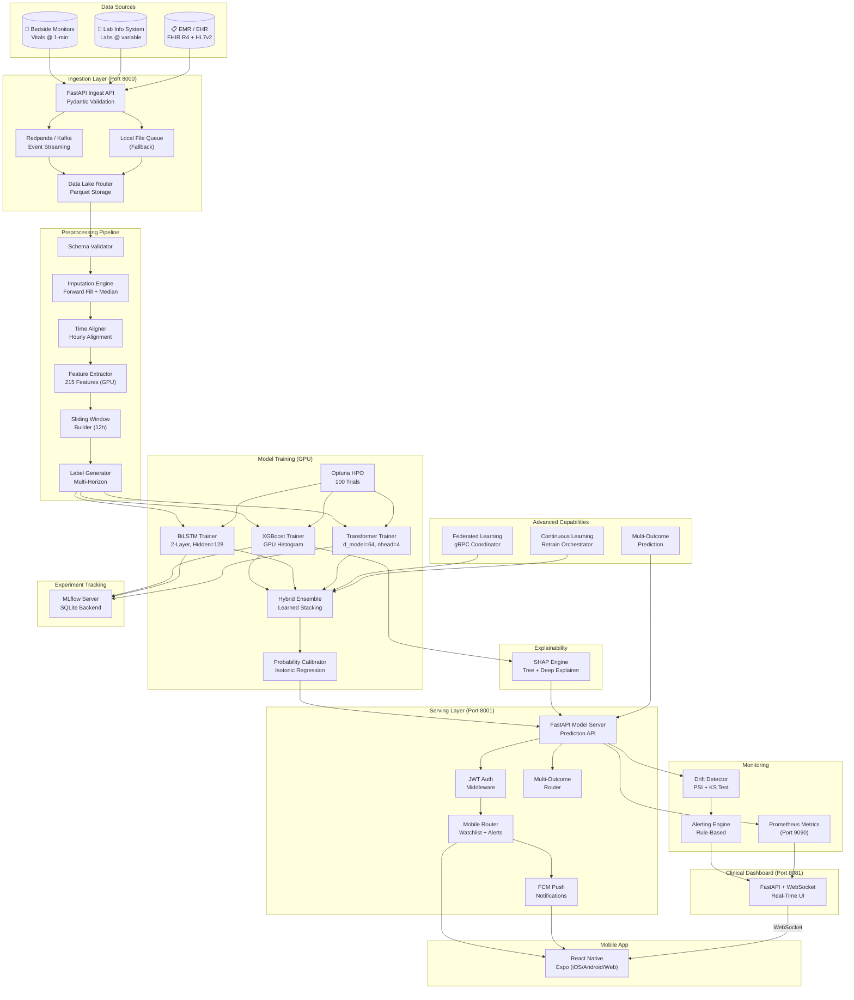
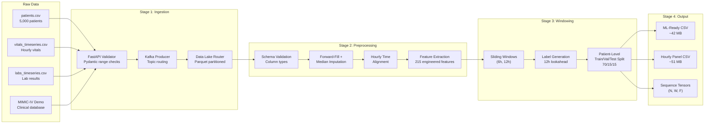
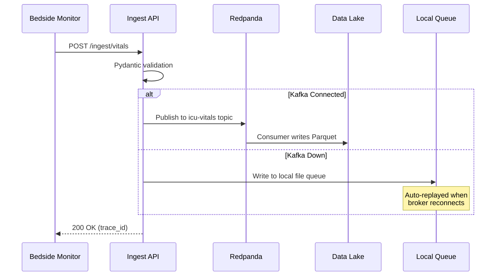
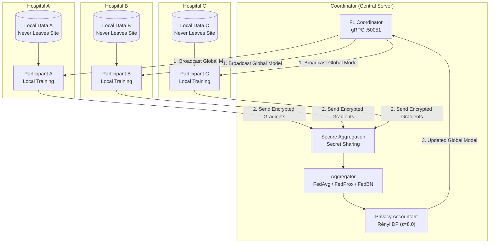
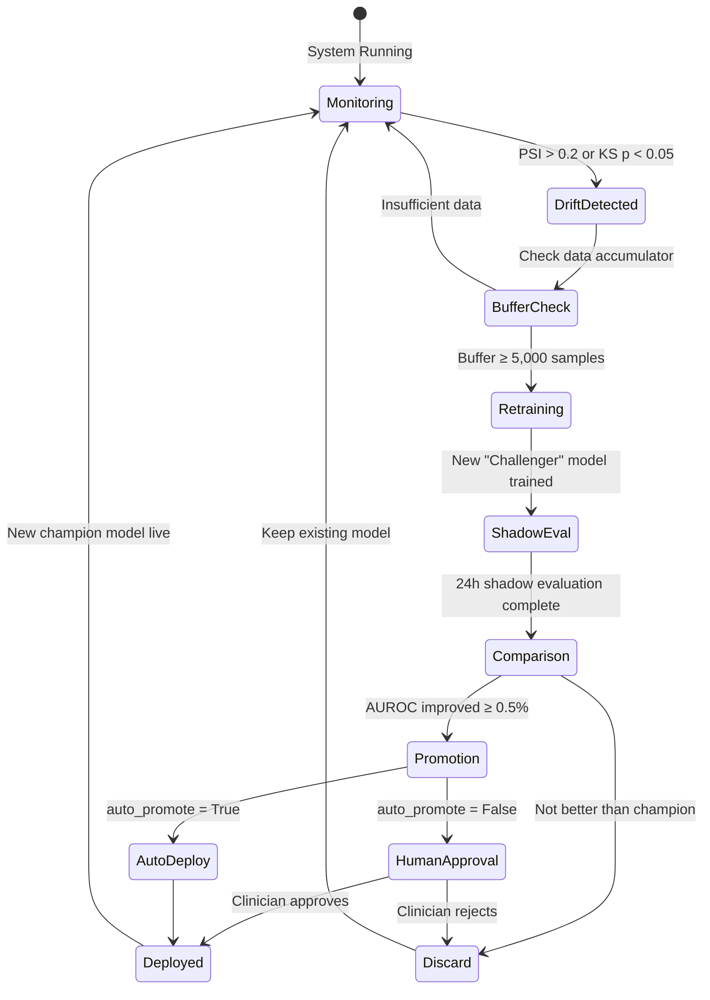

<p align="center">
  
  
  
  
  
  
  
  
</p>

<h1 align="center">🫀 G_One_Sync AI (JeevanSync)</h1>

<p align="center">
  <strong>AI-Powered Early Clinical Deterioration Prediction System for ICU Patients</strong>
</p>

<p align="center">
  <em>A production-grade, GPU-accelerated clinical ML platform that predicts patient deterioration<br/>
  up to 12 hours before clinical onset — enabling proactive critical care interventions.</em>
</p>

---

## 📋 Table of Contents

- [Overview](#-overview)
- [Key Features](#-key-features)
- [System Architecture](#-system-architecture)
- [Data Pipeline Architecture](#-data-pipeline-architecture)
- [Project Structure](#-project-structure)
- [Technology Stack](#-technology-stack)
- [Getting Started](#-getting-started)
- [Data Ingestion](#-data-ingestion)
- [Preprocessing Pipeline](#-preprocessing-pipeline)
- [Model Training](#-model-training)
- [Model Performance](#-model-performance)
- [Probability Calibration](#-probability-calibration)
- [SHAP Explainability](#-shap-explainability)
- [Serving API](#-serving-api)
- [Clinical Dashboard](#-clinical-dashboard)
- [Mobile Companion App](#-mobile-companion-app)
- [EMR/EHR Integration](#-emrehr-integration)
- [Federated Learning](#-federated-learning)
- [Continuous Learning](#-continuous-learning)
- [Multi-Outcome Prediction](#-multi-outcome-prediction)
- [Monitoring & Alerting](#-monitoring--alerting)
- [Regulatory Compliance](#-regulatory-compliance)
- [Docker Deployment](#-docker-deployment)
- [CI/CD Pipeline](#-cicd-pipeline)
- [Configuration System](#-configuration-system)
- [Testing](#-testing)
- [Contributing](#-contributing)
- [License](#-license)

---

## 🌟 Overview

**G_One_Sync AI** (internally codename *JeevanSync* — "life sync" in Hindi) is a comprehensive clinical decision support system designed to predict patient deterioration in Intensive Care Unit (ICU) settings. The system ingests real-time physiological data streams — vital signs, laboratory results, and clinical observations — and produces calibrated risk scores with full SHAP-based explanations for every prediction.

### The Clinical Problem

In ICU settings, **clinical deterioration is often recognized too late**. Traditional early warning scores (MEWS, NEWS2) rely on static threshold rules and miss subtle physiological trends that precede adverse events. Studies show that up to **40% of ICU cardiac arrests** have documented preceding warning signs that were missed or acted upon too slowly.

### Our Solution

G_One_Sync AI addresses this by:

1. **Continuous monitoring** — Ingesting vitals and labs at sub-hourly frequency
2. **Temporal pattern recognition** — Using sliding windows and deep learning to capture trends
3. **Multi-model ensemble** — Combining XGBoost, BiLSTM, and Transformer architectures
4. **Calibrated probabilities** — Ensuring predicted risk percentages are clinically meaningful
5. **Explainable predictions** — SHAP waterfall explanations for every patient, every prediction
6. **Proactive alerting** — Push notifications to attending physicians before deterioration occurs

---

## ✨ Key Features

| Category | Feature | Description |
|----------|---------|-------------|
| 🧠 **ML Models** | 3-Model Ensemble | XGBoost + BiLSTM + Transformer with learned stacking weights |
| 🎯 **Prediction** | 12-Hour Horizon | Predicts deterioration up to 12 hours before clinical onset |
| 📊 **Calibration** | Isotonic Regression | ECE → 10⁻⁹ ensuring clinical-grade probability estimates |
| 🔍 **Explainability** | SHAP Waterfall | Per-patient feature importance explanations (TreeExplainer + DeepExplainer) |
| 📡 **Streaming** | Kafka/Redpanda | Real-time data ingestion with local file queue fallback |
| 🏥 **EMR Integration** | FHIR R4 + HL7v2 | Native integration with hospital EHR systems |
| 🌐 **Federated Learning** | Multi-Site Training | Privacy-preserving training across hospitals with differential privacy |
| 🔄 **Continuous Learning** | Drift-Triggered Retraining | Automatic retraining with champion/challenger promotion |
| 📱 **Mobile App** | React Native (Expo) | Companion app for physicians with push notifications |
| 🖥️ **Dashboard** | Real-Time WebSocket | Clinical monitoring dashboard with live risk tracking |
| 🔒 **Security** | JWT + HIPAA-ready | Role-based access, audit trails, encrypted communications |
| ⚖️ **Compliance** | FDA 510(k) Ready | Full IEC 62304, ISO 14971, QMS documentation |
| 🐳 **Deployment** | GPU Docker Stack | NVIDIA CUDA containers with health checks |
| 📈 **Monitoring** | Prometheus + Drift | Performance metrics, data drift detection, clinical alerting |

---

## 🏗 System Architecture



---

## 🔄 Data Pipeline Architecture



### Engineered Features (215 total)

For each of the 15 numeric input signals, the feature extractor computes:

| Feature Type | Count per Signal | Example |
|-------------|-----------------|---------|
| Latest value | 1 | `heart_rate_latest` |
| Mean | 1 | `heart_rate_mean` |
| Std deviation | 1 | `heart_rate_std` |
| Min / Max | 2 | `heart_rate_min`, `heart_rate_max` |
| Median | 1 | `heart_rate_median` |
| Slope (linear trend) | 1 | `heart_rate_slope` |
| Delta (first-last) | 1 | `heart_rate_delta` |
| Rate of change | 1 | `heart_rate_roc` |
| Acceleration | 1 | `heart_rate_accel` |
| Coefficient of variation | 1 | `heart_rate_cv` |
| IQR | 1 | `heart_rate_iqr` |
| Skewness | 1 | `heart_rate_skew` |
| Kurtosis | 1 | `heart_rate_kurt` |

Plus clinical composite scores:
- **Shock Index** (HR / SBP) — current, mean, max
- **MAP** (Mean Arterial Pressure) — current, mean
- **qSOFA Score** — bedside sepsis screening
- **Age, gender, comorbidity index, admission type** — static features

---

## 📁 Project Structure

```
G_One_Sync_AI/
│
├── config/                          # Centralized configuration
│   ├── __init__.py
│   ├── settings.py                  # 11 Pydantic settings classes
│   └── logging_config.py            # Loguru structured logging setup
│
├── src/                             # Core application source code
│   ├── ingestion/                   # Data ingestion layer
│   │   ├── ingest_api.py            # FastAPI REST ingest server (port 8000)
│   │   ├── schemas.py               # Pydantic validation schemas
│   │   ├── kafka_producer.py        # Redpanda/Kafka event producer
│   │   ├── kafka_consumer.py        # Stream consumer for preprocessing
│   │   ├── data_lake_router.py      # Parquet-based data lake storage
│   │   ├── simulate_stream.py       # ICU data stream simulator
│   │   └── emr/                     # EMR/EHR integration
│   │       ├── fhir_client.py       # FHIR R4 REST client
│   │       ├── fhir_mapper.py       # FHIR → internal format mapper
│   │       ├── fhir_schemas.py      # FHIR resource Pydantic models
│   │       ├── fhir_subscription.py # FHIR R4 subscription handler
│   │       ├── hl7_listener.py      # HL7v2 MLLP TCP listener
│   │       ├── hl7_parser.py        # HL7v2 message parser (ORU^R01)
│   │       ├── hl7_mapper.py        # HL7v2 → internal format mapper
│   │       └── audit_logger.py      # PHI access audit trail
│   │
│   ├── preprocessing/               # Feature engineering pipeline
│   │   ├── pipeline.py              # End-to-end orchestrator
│   │   ├── schema_validator.py      # Column type & range validation
│   │   ├── imputation.py            # Forward-fill + median imputation
│   │   ├── time_alignment.py        # Hourly time alignment
│   │   ├── feature_extractor.py     # CPU feature extraction (215 features)
│   │   ├── gpu_feature_extractor.py # GPU-accelerated feature extraction
│   │   ├── sliding_window.py        # Temporal sliding windows (6h, 12h)
│   │   └── label_generator.py       # Multi-horizon label generation
│   │
│   ├── modeling/                     # ML model training
│   │   ├── train_pipeline.py        # End-to-end training orchestrator
│   │   ├── base_trainer.py          # Abstract base class for all trainers
│   │   ├── xgboost_trainer.py       # XGBoost GPU histogram trainer
│   │   ├── lstm_trainer.py          # Bidirectional LSTM trainer
│   │   ├── transformer_trainer.py   # Multi-head attention Transformer
│   │   ├── ensemble.py              # Hybrid ensemble (learned stacking)
│   │   ├── calibration.py           # Isotonic + Platt + Temperature scaling
│   │   ├── hpo.py                   # Optuna hyperparameter optimization
│   │   ├── losses.py                # Focal Loss for class imbalance
│   │   ├── data_loader.py           # Train/val/test data loading
│   │   ├── experiment_tracker.py    # MLflow experiment tracking wrapper
│   │   └── multi_outcome/           # Multi-outcome prediction
│   │       ├── multi_head_model.py  # Shared-trunk multi-head Transformer
│   │       ├── multi_label_trainer.py # Multi-task training loop
│   │       ├── label_definitions.py # Outcome-specific label generators
│   │       └── outcome_schemas.py   # Multi-outcome API schemas
│   │
│   ├── explainability/              # Model interpretability
│   │   └── shap_explainer.py        # SHAP TreeExplainer + DeepExplainer
│   │
│   ├── serving/                     # Model serving API
│   │   ├── model_server.py          # FastAPI prediction server (port 8001)
│   │   ├── auth.py                  # JWT authentication middleware
│   │   ├── mobile_router.py         # Mobile-specific API endpoints
│   │   ├── mobile_schemas.py        # Mobile API Pydantic schemas
│   │   ├── multi_outcome_router.py  # Multi-outcome prediction endpoints
│   │   └── push_notifications.py    # Firebase Cloud Messaging integration
│   │
│   ├── monitoring/                  # Production monitoring
│   │   ├── metrics_collector.py     # Prometheus metrics exporter
│   │   ├── drift_detector.py        # PSI + KS-test drift detection
│   │   └── alerting.py              # Clinical alerting engine
│   │
│   ├── dashboard/                   # Clinical monitoring dashboard
│   │   ├── app.py                   # FastAPI + WebSocket dashboard server
│   │   └── static/                  # Dashboard HTML/CSS/JS assets
│   │
│   ├── continuous/                  # Continuous learning pipeline
│   │   ├── retrain_orchestrator.py  # Drift-triggered retraining coordinator
│   │   ├── data_accumulator.py      # Production data buffer for retraining
│   │   ├── champion_challenger.py   # A/B model comparison evaluation
│   │   ├── shadow_evaluator.py      # Shadow mode model evaluation
│   │   └── model_versioner.py       # Model version management
│   │
│   └── federated/                   # Federated learning
│       ├── coordinator.py           # Central FL coordinator server
│       ├── participant.py           # Hospital-site FL participant
│       ├── aggregator.py            # FedAvg / FedProx / FedBN strategies
│       ├── fl_schemas.py            # FL protocol Pydantic schemas
│       ├── privacy.py               # Rényi Differential Privacy accountant
│       ├── secure_aggregation.py    # Secure aggregation protocol
│       └── proto/                   # gRPC protobuf definitions
│
├── mobile/                          # React Native companion app
│   ├── App.tsx                      # Root application component
│   ├── src/
│   │   ├── screens/                 # App screens
│   │   │   ├── LoginScreen.tsx      # Physician authentication
│   │   │   ├── DashboardScreen.tsx  # Patient overview & risk scores
│   │   │   ├── PatientDetailScreen.tsx # Individual patient details + SHAP
│   │   │   └── AlertsScreen.tsx     # Alert history & management
│   │   ├── components/              # Reusable UI components
│   │   │   ├── RiskBadge.tsx        # Color-coded risk level badge
│   │   │   ├── VitalCard.tsx        # Vital sign display card
│   │   │   └── SHAPChart.tsx        # SHAP waterfall visualization
│   │   ├── navigation/             # React Navigation setup
│   │   ├── services/               # API client & push notifications
│   │   ├── types/                  # TypeScript type definitions
│   │   └── utils/                  # Constants & helpers
│   ├── app.json                    # Expo configuration
│   ├── package.json                # Node.js dependencies
│   └── tsconfig.json               # TypeScript configuration
│
├── tests/                           # Comprehensive test suite
│   ├── test_ingestion.py            # Ingest API endpoint tests
│   ├── test_preprocessing.py        # Feature extraction & pipeline tests
│   ├── test_modeling.py             # Model training & prediction tests
│   ├── test_serving.py              # Serving API endpoint tests
│   ├── test_emr_integration.py      # FHIR + HL7v2 integration tests
│   ├── test_federated.py           # Federated learning tests
│   ├── test_continuous_learning.py  # Continuous learning lifecycle tests
│   ├── test_mobile_api.py          # Mobile API & auth tests
│   └── test_multi_outcome.py       # Multi-outcome prediction tests
│
├── compliance/                      # FDA/regulatory compliance artifacts
│   ├── design_controls/            # IEC 62304 design documentation
│   │   ├── user_needs.md           # Clinical user requirements
│   │   ├── design_inputs.md        # Technical specifications
│   │   ├── design_outputs.md       # Implementation documentation
│   │   ├── design_verification.md  # Verification test results
│   │   └── design_validation.md    # Clinical validation summary
│   ├── risk_management/            # ISO 14971 risk management
│   │   ├── risk_analysis.md        # Comprehensive risk analysis
│   │   ├── fmea.md                 # Failure Mode & Effects Analysis
│   │   ├── hazard_log.md           # Hazard identification log
│   │   └── risk_benefit_analysis.md # Risk-benefit assessment
│   ├── qms/                        # Quality Management System SOPs
│   │   ├── SOP-001_design_controls.md
│   │   ├── SOP-002_risk_management.md
│   │   ├── SOP-003_software_lifecycle.md
│   │   ├── SOP-004_change_management.md
│   │   ├── SOP-005_complaint_handling.md
│   │   └── SOP-006_corrective_actions.md
│   ├── templates/                  # Regulatory document templates
│   │   ├── model_card_template.md  # ML Model Card
│   │   └── intended_use_statement.md # FDA intended use
│   ├── traceability/               # Requirements traceability
│   │   ├── traceability_matrix.md  # Requirements → Tests matrix
│   │   └── traceability_matrix.json # Machine-readable traceability
│   ├── sbom/                       # Software Bill of Materials
│   │   ├── sbom.json               # CycloneDX SBOM
│   │   └── sbom_report.md          # Human-readable SBOM report
│   └── scripts/                    # Compliance automation scripts
│
├── docs/                            # Clinical & regulatory documentation
│   └── regulatory/
│       ├── clinical_validation/    # Clinical trial protocol
│       │   ├── study_protocol.md
│       │   ├── statistical_analysis_plan.md
│       │   ├── sample_size_calculation.md
│       │   ├── inclusion_exclusion.md
│       │   └── endpoints.md
│       ├── performance_report/     # Model performance documentation
│       │   ├── calibration_analysis.md
│       │   ├── failure_mode_analysis.md
│       │   ├── sensitivity_specificity.md
│       │   └── subgroup_analysis.md
│       └── predicate_comparison/   # 510(k) predicate analysis
│           ├── substantial_equivalence.md
│           ├── mews_comparison.md
│           └── news2_comparison.md
│
├── docker/                          # Containerization
│   ├── Dockerfile                   # NVIDIA CUDA 12.4 base image
│   └── docker-compose.yml           # Full service stack (6 services)
│
├── scripts/                         # Utility scripts
│   └── simulate_emr_feed.py        # EMR data feed simulator
│
├── dataset/                         # Raw data files
│   ├── patients.csv                 # 5,000 synthetic ICU patients
│   ├── vitals_timeseries.csv        # Hourly vital sign measurements
│   ├── labs_timeseries.csv          # Lab results time series
│   ├── hospital_deterioration_hourly_panel.csv  # Merged hourly panel (~51 MB)
│   ├── hospital_deterioration_ml_ready.csv      # ML-ready features (~42 MB)
│   └── mimic-iv-clinical-database-demo-2.2/     # MIMIC-IV demo data
│
├── data/                            # Runtime data directories
│   ├── datalake/                   # Ingested data (Parquet)
│   ├── processed/                  # Preprocessed datasets
│   ├── local_queue/                # Kafka fallback queue
│   └── audit/                      # PHI access audit logs
│
├── models/                          # Trained model artifacts
│   └── artifacts/
│       ├── xgboost/                # XGBoost model files
│       ├── bilstm/                 # BiLSTM PyTorch checkpoints
│       ├── transformer/            # Transformer PyTorch checkpoints
│       ├── federated/              # Federated learning checkpoints
│       ├── explanations/           # SHAP explanation artifacts
│       ├── training_summary.json   # Complete metrics for all models
│       └── optimal_thresholds.json # Clinically-optimized thresholds
│
├── .github/workflows/              # CI/CD pipelines
│   ├── ci.yml                      # Lint + Test + Compliance validation
│   └── cd.yml                      # Docker build + Registry push
│
├── requirements.txt                 # Python dependencies (32 packages)
├── pyproject.toml                   # Project metadata + tool config
├── mlflow.db                        # MLflow experiment database
└── report/                          # Academic report
    └── Part1_Abstract_AreaOfWork_Ch1.md
```

---

## 🛠 Technology Stack

### Backend & ML

| Component | Technology | Purpose |
|-----------|-----------|---------|
| Language | Python 3.10+ | Core runtime |
| ML Framework | PyTorch 2.x (CUDA 12.4) | Deep learning training & inference |
| Gradient Boosting | XGBoost 2.1+ (GPU) | Tabular feature model |
| API Framework | FastAPI 0.111+ | REST APIs + WebSocket |
| ASGI Server | Uvicorn | Production server |
| Data Processing | Pandas 2.2+ / NumPy 2.0+ | Data manipulation |
| Experiment Tracking | MLflow 2.14+ | Model versioning & metrics |
| HPO | Optuna 3.6+ | Bayesian hyperparameter search |
| Explainability | SHAP 0.45+ | Feature importance explanations |
| Streaming | Redpanda (Kafka-compatible) | Event streaming |
| Monitoring | Prometheus Client 0.20+ | Metrics collection |
| Visualization | Plotly 5.22+ | Dashboard charts |
| Logging | Loguru 0.7+ | Structured JSON logging |
| Validation | Pydantic 2.7+ / Pydantic-Settings | Schema validation & config |
| Privacy | Opacus 1.5+ | Differential privacy for FL |
| EMR | fhirpy 2.0+ / hl7apy 1.3+ | FHIR R4 + HL7v2 integration |
| Auth | PyJWT 2.8+ / bcrypt 4.1+ | JWT token authentication |
| gRPC | grpcio 1.64+ | Federated learning transport |
| Linting | Ruff | Formatting & linting |

### Frontend & Mobile

| Component | Technology | Purpose |
|-----------|-----------|---------|
| Mobile Framework | React Native 0.86 | Cross-platform mobile app |
| Mobile Platform | Expo SDK 57 | Build & deploy tooling |
| Language | TypeScript 5.8+ | Type-safe mobile development |
| Push Notifications | Firebase Cloud Messaging | Real-time clinical alerts |
| Biometrics | expo-local-authentication | Secure physician login |

### Infrastructure

| Component | Technology | Purpose |
|-----------|-----------|---------|
| Container Runtime | Docker + Docker Compose | Service orchestration |
| GPU Base Image | nvidia/cuda:12.4.0-runtime | GPU inference support |
| Message Broker | Redpanda v24.1.1 | Kafka-compatible streaming |
| ML Registry | MLflow v2.16.0 | Model artifact storage |
| CI/CD | GitHub Actions | Automated testing & deployment |

---

## 🚀 Getting Started

### Prerequisites

- **Python 3.10+**
- **NVIDIA GPU** with CUDA 12.4 drivers (recommended: RTX 3050 4GB+)
- **Node.js 18+** (for mobile app)
- **Docker & Docker Compose** (for containerized deployment)

### 1. Clone & Setup

```bash
git clone https://github.com/Shubhammm24/G_One_Sync_AI.git
cd G_One_Sync_AI

# Create virtual environment
python -m venv venv
source venv/bin/activate  # Linux/Mac
venv\Scripts\activate     # Windows

# Install dependencies
pip install -r requirements.txt

# Install PyTorch with CUDA 12.4
pip install torch torchvision torchaudio --index-url https://download.pytorch.org/whl/cu124
```

### 2. Run the Preprocessing Pipeline

```bash
python -m src.preprocessing.pipeline
```

This executes the full preprocessing chain: validation → imputation → time alignment → feature extraction → label generation → patient-level train/val/test split.

### 3. Train Models

```bash
# Train all models (XGBoost + BiLSTM + Transformer + Ensemble)
python -m src.modeling.train_pipeline

# Train specific model
python -m src.modeling.train_pipeline --model xgboost

# Train with hyperparameter optimization
python -m src.modeling.train_pipeline --model all --hpo
```

### 4. Start the Serving API

```bash
# Start prediction server (port 8001)
uvicorn src.serving.model_server:app --host 0.0.0.0 --port 8001

# Start ingestion server (port 8000)
uvicorn src.ingestion.ingest_api:app --host 0.0.0.0 --port 8000

# Start clinical dashboard (port 8081)
uvicorn src.dashboard.app:app --host 0.0.0.0 --port 8081
```

### 5. Launch Mobile App

```bash
cd mobile
npm install
npx expo start --web   # Web browser
npx expo start          # Expo Go (iOS/Android)
```

---

## 📡 Data Ingestion

The ingestion layer provides high-throughput, validated data entry points for ICU data streams.

### Ingestion API (Port 8000)

| Endpoint | Method | Description |
|----------|--------|-------------|
| `/health` | GET | Health check with Kafka status |
| `/ingest/vitals` | POST | Single vital sign measurement |
| `/ingest/labs` | POST | Single lab result |
| `/ingest/batch` | POST | Batch vitals + labs payload |
| `/ingest/flat` | POST | Flat CSV-like row ingestion |

### Data Validation

All incoming data is validated against clinical ranges using Pydantic:

| Vital Sign | Valid Range | Unit |
|-----------|------------|------|
| Heart Rate | 20 – 300 | BPM |
| Respiratory Rate | 4 – 60 | breaths/min |
| SpO₂ | 50 – 100 | % |
| Temperature | 30.0 – 45.0 | °C |
| Systolic BP | 40 – 300 | mmHg |
| Diastolic BP | 20 – 200 | mmHg |

### Streaming Architecture



---

## ⚙️ Preprocessing Pipeline

The preprocessing pipeline transforms raw clinical data into ML-ready feature matrices.

### Pipeline Stages

```
Raw CSV Data
    │
    ▼
┌─────────────────┐
│ Schema Validator │  Validates column types, detects missing columns
└────────┬────────┘
         ▼
┌─────────────────┐
│ Imputation      │  Forward-fill + group-median for missing values
│ Engine          │  Per-patient temporal imputation
└────────┬────────┘
         ▼
┌─────────────────┐
│ Time Aligner    │  Aligns irregular samples to hourly grid
└────────┬────────┘
         ▼
┌─────────────────┐
│ Feature         │  Extracts 215 statistical features from sliding
│ Extractor (GPU) │  windows: mean, std, slope, delta, RoC, etc.
└────────┬────────┘
         ▼
┌─────────────────┐
│ Label Generator │  Creates binary labels: "will deteriorate in
│ (Multi-Horizon) │  next 6/10/12 hours?"
└────────┬────────┘
         ▼
┌─────────────────┐
│ Patient-Level   │  Ensures no data leakage: same patient
│ Train/Val/Test  │  never appears in multiple splits
│ Split (70/15/15)│  Stratified by deterioration rate
└────────┬────────┘
         ▼
    ML-Ready Data
```

### GPU Acceleration

The feature extractor supports GPU-accelerated computation via PyTorch CUDA tensors, providing **3-5× speedup** over CPU on RTX 3050:

```python
# Automatic GPU detection
pipeline = PreprocessingPipeline(use_gpu=True)
# Falls back to CPU if no GPU available
```

---

## 🧠 Model Training

### Model Architectures

#### 1. XGBoost (Gradient Boosted Trees)
- **Input**: Tabular features (215 dimensions)
- **Architecture**: 500 trees, max_depth=8, learning_rate=0.05
- **GPU**: `tree_method="gpu_hist"` for GPU histogram computation
- **Loss**: Weighted binary cross-entropy (class imbalance handling)
- **Strengths**: Best for tabular features, fast inference, interpretable via SHAP

#### 2. BiLSTM (Bidirectional Long Short-Term Memory)
- **Input**: Temporal sequences (N, 12, 11) — 12 timesteps × 11 features
- **Architecture**: 2-layer BiLSTM, hidden_size=128, dropout=0.3
- **Loss**: Focal Loss (γ=2.0, α=0.25) for class imbalance
- **Strengths**: Captures temporal dependencies and sequential patterns

#### 3. Transformer (Multi-Head Attention)
- **Input**: Temporal sequences (N, 12, 11)
- **Architecture**: d_model=64, nhead=4, num_layers=2, positional encoding
- **Loss**: Focal Loss with learned attention weights
- **Strengths**: Captures long-range dependencies, parallelizable

### Ensemble Strategy

The **Hybrid Ensemble** combines all three models using learned stacking:

```
XGBoost Prediction  ─┐
BiLSTM Prediction   ─┤─→ Logistic Regression Meta-Learner ─→ Final Probability
Transformer Pred.   ─┘
```

The meta-learner is fit on validation set predictions, learning optimal model combination weights that maximize AUROC.

### Hyperparameter Optimization

Optuna Bayesian search with MedianPruner:
- **100 trials** per model type
- Optimizes for **validation AUROC**
- Supports GPU-accelerated search
- Early stopping via pruning of unpromising trials

---

## 📊 Model Performance

### Test Set Results

| Model | AUROC | AUPRC | Accuracy | Precision | Recall | F1 | Specificity |
|-------|-------|-------|----------|-----------|--------|------|-------------|
| **XGBoost** | 0.9552 | 0.7219 | 0.9453 | 0.5037 | 0.7810 | 0.6124 | 0.9549 |
| **BiLSTM** | 0.9520 | 0.6680 | 0.9526 | 0.5516 | 0.7694 | 0.6426 | 0.9634 |
| **Transformer** | 0.9492 | 0.6423 | 0.9596 | 0.6320 | 0.6478 | 0.6398 | 0.9779 |
| **🏆 Ensemble** | **0.9579** | **0.7018** | **0.9690** | **0.7691** | **0.6292** | **0.6921** | **0.9889** |

### Key Takeaways

- **Ensemble achieves the highest AUROC (0.9579)** and best overall balance
- **XGBoost leads in AUPRC (0.7219)** — best at ranking deterioration risk
- **Transformer achieves highest specificity (0.9779)** — fewest false alarms
- **BiLSTM achieves highest recall (0.7694)** — catches the most true deteriorations

### Top Predictive Features (SHAP)

| Rank | Feature | SHAP Importance | Clinical Meaning |
|------|---------|----------------|------------------|
| 1 | `lactate_delta` | 1.020 | Tissue hypoperfusion / sepsis marker |
| 2 | `creatinine_delta` | 0.646 | Renal function deterioration |
| 3 | `spo2_pct_latest` | 0.471 | Current oxygenation status |
| 4 | `shock_index_current` | 0.431 | Compensated shock indicator (HR/SBP) |
| 5 | `crp_level_delta` | 0.303 | Systemic inflammation trend |
| 6 | `mobility_score_mean` | 0.302 | Functional status indicator |
| 7 | `respiratory_rate_latest` | 0.267 | Respiratory distress |
| 8 | `wbc_count_delta` | 0.264 | Immune response / infection |
| 9 | `lactate_latest` | 0.244 | Absolute lactate level |
| 10 | `mobility_score_slope` | 0.215 | Functional decline trajectory |

---

## 🎯 Probability Calibration

Raw model outputs are calibrated using **Isotonic Regression** to ensure clinical reliability:

| Model | Brier Before | Brier After | Improvement | ECE Before | ECE After |
|-------|-------------|-------------|-------------|-----------|----------|
| XGBoost | 0.0433 | 0.0230 | **46.8%** | 0.0547 | **9.9 × 10⁻⁷** |
| BiLSTM | 0.0621 | 0.0257 | **58.7%** | 0.1625 | **1.0 × 10⁻⁹** |
| Transformer | 0.0583 | 0.0262 | **55.1%** | 0.1709 | **8.4 × 10⁻¹⁰** |

> **ECE → ~10⁻⁹** means that when the model says "70% risk," approximately 70% of those patients truly deteriorate. This is essential for clinical trust.

### Clinically-Optimized Thresholds

| Strategy | Threshold | Precision | Recall | F1 | Use Case |
|---------|-----------|-----------|--------|------|----------|
| F1-Optimal | 0.920 | 0.760 | 0.637 | 0.693 | Balanced alerting |
| Youden's J | 0.196 | 0.342 | 0.856 | 0.489 | Maximum sensitivity screening |
| Clinical | 0.735 | 0.634 | 0.723 | 0.675 | Recommended for ICU use |
| High-Recall | 0.100 | 0.275 | 0.902 | 0.421 | Safety-critical: catch >90% |

---

## 🔍 SHAP Explainability

Every prediction includes a full SHAP explanation — required for regulatory compliance and clinical trust.

### Explainer Types

| Model Type | SHAP Explainer | Method |
|-----------|---------------|--------|
| XGBoost | `TreeExplainer` | Exact SHAP values (polynomial time) |
| BiLSTM | `DeepExplainer` | Gradient-based approximation |
| Transformer | `DeepExplainer` | Gradient-based approximation |

### Example Patient Explanation

```json
{
  "patient_id": 1902,
  "deterioration_probability": 0.82,
  "risk_level": "CRITICAL",
  "top_risk_factors": [
    {"feature": "lactate_delta", "shap_value": 1.84, "direction": "increasing"},
    {"feature": "spo2_pct_latest", "shap_value": -0.72, "direction": "decreasing"},
    {"feature": "shock_index_current", "shap_value": 0.65, "direction": "elevated"}
  ],
  "clinical_narrative": "Rising lactate with dropping oxygen saturation and elevated shock index suggest developing septic shock."
}
```

---

## 🌐 Serving API

### Prediction Server (Port 8001)

| Endpoint | Method | Description |
|----------|--------|-------------|
| `/health` | GET | Health check with loaded models & GPU status |
| `/model/info` | GET | Model metadata, versions, feature count |
| `/predict` | POST | Single patient prediction |
| `/predict/batch` | POST | Batch predictions (up to 100 patients) |
| `/predict/explain` | POST | Prediction + SHAP waterfall explanation |
| `/auth/login` | POST | Physician JWT authentication |
| `/auth/refresh` | POST | Refresh JWT access token |
| `/mobile/watchlist` | GET | Physician's patient watchlist with risk scores |
| `/mobile/patient/{id}` | GET | Single patient risk summary + vitals |
| `/notifications/register` | POST | Register FCM device token |
| `/notifications/test` | POST | Send test push notification |
| `/notifications/{token}` | DELETE | Unregister device |
| `/multi-outcome/predict` | POST | Multi-outcome prediction (sepsis, cardiac, respiratory) |
| `/multi-outcome/health` | GET | Multi-outcome model status |

### Request/Response Example

**Request:**
```bash
curl -X POST http://localhost:8001/predict \
  -H "Content-Type: application/json" \
  -d '{
    "patient_id": 42,
    "vitals": {
      "heart_rate": 112,
      "respiratory_rate": 28,
      "spo2_pct": 88.5,
      "temperature_c": 38.9,
      "systolic_bp": 85,
      "diastolic_bp": 55
    },
    "labs": {
      "wbc_count": 18.5,
      "lactate": 4.2,
      "creatinine": 2.1,
      "crp_level": 180,
      "hemoglobin": 9.5,
      "sepsis_risk_score": 0.72
    },
    "model_type": "ensemble"
  }'
```

**Response:**
```json
{
  "patient_id": 42,
  "deterioration_probability": 0.847,
  "risk_level": "CRITICAL",
  "model_used": "ensemble",
  "confidence_interval": [0.79, 0.89],
  "prediction_timestamp": "2026-10-22T06:00:00Z",
  "inference_time_ms": 23.4
}
```

---

## 🖥 Clinical Dashboard

The real-time clinical monitoring dashboard provides ICU staff with an at-a-glance view of all patients.

### Dashboard Features

- **Patient Risk Overview** — Color-coded risk tiles for all ICU patients
- **Real-Time WebSocket Feed** — Live updates without page refresh
- **Vital Sign Trends** — Interactive Plotly charts for vital sign history
- **Alert Feed** — Clinical, system, and drift alerts with severity levels
- **Drift Monitoring** — PSI and KS-test visualizations
- **System Metrics** — Prediction latency, throughput, model performance

### Routes

| Route | Description |
|-------|-------------|
| `GET /` | Dashboard HTML page |
| `GET /api/metrics` | System + model metrics JSON |
| `GET /api/alerts` | Recent alerts list |
| `GET /api/drift` | Drift detection report |
| `GET /api/patients` | Patient risk overview |
| `WS /ws/live` | WebSocket real-time feed |

### Running the Dashboard

```bash
uvicorn src.dashboard.app:app --host 0.0.0.0 --port 8081
```

---

## 📱 Mobile Companion App

A **React Native (Expo)** companion app for attending physicians to monitor patients remotely.

### Screens

| Screen | Description |
|--------|-------------|
| **Login** | Physician authentication (JWT + optional biometric) |
| **Dashboard** | Patient list with real-time risk scores & trends |
| **Patient Detail** | Individual patient vitals, SHAP chart, alert history |
| **Alerts** | Push notification history with severity filtering |

### Components

| Component | Description |
|-----------|-------------|
| `RiskBadge` | Color-coded risk level indicator (CRITICAL/HIGH/MODERATE/LOW) |
| `VitalCard` | Single vital sign display with trend arrow |
| `SHAPChart` | SHAP waterfall visualization for model explanations |

### Push Notifications

When a patient's risk crosses configurable thresholds, Firebase Cloud Messaging sends push alerts:

- **CRITICAL** (≥ 0.75): Immediate push with vibration
- **HIGH** (≥ 0.50): Standard priority push
- Configurable via `JEEVAN_MOBILE_PUSH_CRITICAL_THRESHOLD` and `JEEVAN_MOBILE_PUSH_HIGH_THRESHOLD`

### Running

```bash
cd mobile
npm install
npx expo start --web      # Web browser
npx expo start --android   # Android emulator
npx expo start --ios       # iOS simulator
```

---

## 🏥 EMR/EHR Integration

Native integration with hospital Electronic Medical Record systems via two industry-standard protocols.

### FHIR R4 Integration

| Feature | Description |
|---------|-------------|
| **FHIR Client** | Async REST client for FHIR R4 servers |
| **Resource Mapper** | Converts FHIR Observation/Patient → internal format |
| **Subscriptions** | Real-time FHIR R4 subscriptions for new observations |
| **OAuth 2.0** | Client credentials authentication |

Supported FHIR Resources:
- `Patient` — Demographics & identifiers
- `Observation` — Vital signs & lab results (LOINC coded)
- `Encounter` — ICU admissions & transfers

### HL7v2 MLLP Integration

| Feature | Description |
|---------|-------------|
| **MLLP Listener** | TCP server on port 2575 for HL7v2 messages |
| **Message Parser** | Parses ORU^R01 (lab results) and ADT^A01 (admissions) |
| **Field Mapper** | Maps HL7v2 segments (OBX, PID, PV1) → internal format |

### Audit Trail

All EMR data access is logged to `data/audit/` with:
- Timestamp, data source, patient identifier
- Operation type (read/write)
- PHI access tracking for HIPAA compliance

### Configuration

```bash
# Enable EMR integration
export JEEVAN_EMR_ENABLED=true
export JEEVAN_EMR_FHIR_BASE_URL=https://ehr.hospital.org/fhir/R4
export JEEVAN_EMR_FHIR_CLIENT_ID=your-client-id
export JEEVAN_EMR_FHIR_CLIENT_SECRET=your-secret
export JEEVAN_EMR_HL7_ENABLED=true
export JEEVAN_EMR_HL7_MLLP_PORT=2575
```

---

## 🌍 Federated Learning

Privacy-preserving multi-site model training without sharing patient data.

### Architecture



### Privacy Guarantees

| Mechanism | Default | Description |
|-----------|---------|-------------|
| **Differential Privacy** | ε = 8.0, δ = 10⁻⁵ | Per-sample gradient clipping + Gaussian noise via Opacus |
| **Secure Aggregation** | Enabled | Shamir secret sharing — coordinator never sees raw updates |
| **Gradient Clipping** | max_norm = 1.0 | Bounds sensitivity for DP guarantees |
| **Privacy Accounting** | Rényi DP | Tight composition tracking across rounds |

### Aggregation Strategies

| Strategy | Description |
|----------|-------------|
| **FedAvg** | Weighted averaging of model parameters |
| **FedProx** | FedAvg + proximal term (μ=0.01) for heterogeneous data |
| **FedBN** | Keeps batch normalization layers local |

### Running Federated Training

```bash
# Start coordinator
export JEEVAN_FL_ENABLED=true
export JEEVAN_FL_FL_ROLE=coordinator
python -m src.federated.coordinator

# Start participant (on each hospital site)
export JEEVAN_FL_ENABLED=true
export JEEVAN_FL_FL_ROLE=participant
export JEEVAN_FL_SITE_ID=hospital-a
python -m src.federated.participant
```

---

## 🔄 Continuous Learning

Drift-triggered automatic retraining with clinical safety gates.

### Lifecycle



### Components

| Component | Description |
|-----------|-------------|
| **Retrain Orchestrator** | Central coordinator for the continuous learning lifecycle |
| **Data Accumulator** | Buffers production data for retraining (max 500 MB) |
| **Shadow Evaluator** | Runs challenger model in shadow mode for 24 hours |
| **Champion/Challenger** | A/B comparison requiring AUROC improvement ≥ 0.5% |
| **Model Versioner** | Manages up to 10 model versions with metadata |

### Safety Gates

> **By default, `auto_promote = False`.** In a clinical safety system, model promotion requires human approval. Automatic promotion should only be enabled after FDA clearance for adaptive AI.

---

## 🎯 Multi-Outcome Prediction

Extends the binary deterioration model to simultaneously predict multiple clinical events.

### Predicted Outcomes

| Outcome | Horizon | Task Weight |
|---------|---------|-------------|
| General Deterioration | 12 hours | 1.0 |
| Sepsis | 6 hours | 1.5 |
| Cardiac Arrest | 12 hours | 2.0 |
| Respiratory Failure | 12 hours | 1.5 |

### Architecture

```
Input Features (215)
        │
        ▼
┌───────────────────┐
│  Shared Trunk     │  Transformer encoder (d=64, h=4, L=2)
│  (Feature Fusion) │
└───────┬───────────┘
        │
    ┌───┼───┬───┐
    ▼   ▼   ▼   ▼
┌─────┐┌─────┐┌─────┐┌─────┐
│Head1││Head2││Head3││Head4│  Task-specific classification heads
│Deter││Sepsi││Cardi││Respi│  (Linear → ReLU → Dropout → Sigmoid)
└─────┘└─────┘└─────┘└─────┘
```

### Multi-Task Loss

```
L_total = Σᵢ wᵢ · FocalLoss(ŷᵢ, yᵢ)
```

Where `wᵢ` are task weights proportional to outcome rarity (higher weight for rarer events like cardiac arrest).

---

## 📈 Monitoring & Alerting

### Prometheus Metrics

| Metric | Type | Description |
|--------|------|-------------|
| `predictions_total` | Counter | Total predictions served |
| `prediction_latency_ms` | Histogram | Inference time per request |
| `high_risk_predictions` | Counter | Predictions with risk > 0.5 |
| `model_loaded` | Gauge | Currently loaded model types |
| `drift_psi_score` | Gauge | Latest PSI drift score |

### Drift Detection

| Method | Threshold | Meaning |
|--------|-----------|---------|
| **PSI < 0.1** | No drift | Distributions stable |
| **0.1 ≤ PSI < 0.2** | Moderate | Monitor closely |
| **PSI ≥ 0.25** | Significant | Trigger retraining |
| **KS p < 0.05** | Statistical | Distribution shift detected |

### Clinical Alerting

The alerting engine supports rule-based alerts with severity levels and cooldowns:

| Alert Type | Source | Example |
|-----------|--------|---------|
| **Patient Deterioration** | Clinical | "Patient 42: Risk 87% (CRITICAL)" |
| **Vital Sign Out of Range** | Clinical | "Patient 15: SpO₂ dropped to 82%" |
| **Data Drift Detected** | System | "Feature lactate_delta PSI = 0.31" |
| **Model Performance Drop** | System | "Serving AUROC dropped below 0.90" |
| **Data Quality Issue** | System | "12% missing values in last hour" |

---

## ⚖️ Regulatory Compliance

G_One_Sync AI maintains **FDA 510(k) submission readiness** with comprehensive compliance documentation.

### Standards Compliance

| Standard | Scope | Status |
|----------|-------|--------|
| **IEC 62304** | Medical device software lifecycle | ✅ Design controls documented |
| **ISO 14971** | Risk management for medical devices | ✅ FMEA + hazard log maintained |
| **ISO 13485** | Quality management systems | ✅ 6 SOPs documented |
| **21 CFR Part 820** | FDA Quality System Regulation | ✅ QMS framework in place |
| **HIPAA** | Patient data privacy | ✅ PHI audit trails |

### Compliance Artifacts

```
compliance/
├── design_controls/         # IEC 62304
│   ├── user_needs.md        # UN-001 through UN-005
│   ├── design_inputs.md     # DI-001 through DI-015
│   ├── design_outputs.md    # DO-001 through DO-010
│   ├── design_verification.md
│   └── design_validation.md
├── risk_management/         # ISO 14971
│   ├── risk_analysis.md     # Comprehensive risk matrix
│   ├── fmea.md              # Failure Mode & Effects Analysis
│   ├── hazard_log.md        # Active hazard tracking
│   └── risk_benefit_analysis.md
├── qms/                     # Quality Management SOPs
│   ├── SOP-001 through SOP-006
├── templates/
│   ├── model_card_template.md
│   └── intended_use_statement.md
├── traceability/            # Requirements ↔ Tests
│   ├── traceability_matrix.md
│   └── traceability_matrix.json
└── sbom/                    # Software Bill of Materials
    ├── sbom.json            # CycloneDX format
    └── sbom_report.md
```

### Predicate Comparison

The system is benchmarked against FDA-cleared predicate devices:
- **MEWS** (Modified Early Warning Score) — G_One_Sync achieves significantly higher AUROC
- **NEWS2** (National Early Warning Score 2) — Improved sensitivity with similar specificity

---

## 🐳 Docker Deployment

### Service Stack

```yaml
# docker/docker-compose.yml
services:
  prediction-api    # Port 8001 — Model serving (GPU)
  ingest-api        # Port 8000 — Data ingestion
  redpanda          # Port 9092 — Kafka-compatible streaming
  mlflow            # Port 5000 — Experiment tracking
  hl7-listener      # Port 2575 — HL7v2 MLLP (emr profile)
  fl-coordinator    # Port 50051 — Federated learning (federated profile)
```

### Quick Start

```bash
# Start core services
docker-compose -f docker/docker-compose.yml up -d

# Start with EMR integration
docker-compose -f docker/docker-compose.yml --profile emr up -d

# Start with federated learning
docker-compose -f docker/docker-compose.yml --profile federated up -d

# Start everything
docker-compose -f docker/docker-compose.yml --profile emr --profile federated up -d
```

### GPU Requirements

The serving container uses NVIDIA GPU passthrough:
- **Base image**: `nvidia/cuda:12.4.0-runtime-ubuntu22.04`
- **Minimum**: NVIDIA GPU with 4GB VRAM
- **Recommended**: RTX 3050 or higher
- Health checks via `curl -f http://localhost:8001/health`

---

## 🔁 CI/CD Pipeline

### Continuous Integration (`.github/workflows/ci.yml`)

Triggers on push to `main`/`develop` and PRs to `main`:

```mermaid
graph LR
    A[Push / PR] --> B[Checkout]
    B --> C["Setup Python<br/>3.11 + 3.12 matrix"]
    C --> D[Install Dependencies]
    D --> E["Ruff Lint<br/>src/ config/"]
    E --> F["Import Validation<br/>All core modules"]
    F --> G["Pytest Suite<br/>+ Coverage"]
    G --> H["Generate SBOM<br/>CycloneDX"]
    H --> I["Validate Model Card"]
    I --> J["Generate<br/>Traceability Matrix"]
    J --> K["Backwards<br/>Compatibility Check"]
    K --> L["Upload Artifacts<br/>Coverage + Compliance"]
```



### Continuous Deployment (`.github/workflows/cd.yml`)

Triggers on push to `main` and version tags (`v*`):

1. **Validate Models** — Import all model modules, verify integrity
2. **Validate Serving** — Import serving module, verify app creation
3. **Build Docker** — Build with Docker Buildx, push to GHCR
4. **Health Check** — Dry-run container validation

---

## ⚙️ Configuration System

All configuration is centralized in `config/settings.py` using **pydantic-settings** with environment variable overrides.

### Configuration Groups

| Class | Env Prefix | Fields | Purpose |
|-------|-----------|--------|---------|
| `DataSettings` | `JEEVAN_DATA_` | 9 | Dataset paths, output directories |
| `KafkaSettings` | `JEEVAN_KAFKA_` | 7 | Broker config, topics, fallback |
| `FeatureSettings` | `JEEVAN_FEATURE_` | 12 | Features, columns, split ratios |
| `APISettings` | `JEEVAN_API_` | 5 | Ingestion API host/port/CORS |
| `ModelSettings` | `JEEVAN_MODEL_` | 14 | Training hyperparams, MLflow, GPU |
| `ServingSettings` | `JEEVAN_SERVING_` | 4 | Prediction server config |
| `EMRSettings` | `JEEVAN_EMR_` | 12 | FHIR R4 + HL7v2 configuration |
| `FederatedSettings` | `JEEVAN_FL_` | 17 | FL roles, rounds, privacy, gRPC |
| `ContinuousSettings` | `JEEVAN_CL_` | 11 | Drift, retraining, promotion |
| `MobileSettings` | `JEEVAN_MOBILE_` | 11 | JWT, FCM, push thresholds |
| `MultiOutcomeSettings` | `JEEVAN_MULTI_` | 10 | Multi-task targets, architecture |

### Example Overrides

```bash
# Enable GPU inference
export JEEVAN_MODEL_USE_GPU=true

# Change prediction server port
export JEEVAN_SERVING_SERVING_PORT=9001

# Enable federated learning
export JEEVAN_FL_ENABLED=true
export JEEVAN_FL_FL_ROLE=coordinator

# Enable continuous learning with auto-promotion
export JEEVAN_CL_CONTINUOUS_ENABLED=true
export JEEVAN_CL_AUTO_PROMOTE=true

# Enable mobile auth
export JEEVAN_MOBILE_AUTH_ENABLED=true
export JEEVAN_MOBILE_JWT_SECRET=your-secret-key
```

---

## 🧪 Testing

### Test Suite Overview

| Test File | Module Tested | Coverage |
|-----------|--------------|----------|
| `test_ingestion.py` | Ingest API endpoints | Vitals, labs, batch, health |
| `test_preprocessing.py` | Pipeline, features, imputation | Feature count, validation |
| `test_modeling.py` | Trainers, ensemble, calibration | Predictions, metrics |
| `test_serving.py` | Serving API endpoints | Predict, health, batch |
| `test_emr_integration.py` | FHIR + HL7v2 integration | Parsing, mapping, audit |
| `test_federated.py` | FL coordinator + participant | Registration, rounds, DP |
| `test_continuous_learning.py` | Retrain orchestrator | Drift, shadow eval, promotion |
| `test_mobile_api.py` | Mobile API + auth | JWT, watchlist, push |
| `test_multi_outcome.py` | Multi-outcome prediction | Multi-head, labels, API |

### Running Tests

```bash
# Full test suite with coverage
pytest tests/ -v --cov=src --cov-report=term-missing --tb=short

# Specific module
pytest tests/test_serving.py -v

# With HTML coverage report
pytest tests/ -v --cov=src --cov-report=html

# CI equivalent
ruff check src/ config/ --ignore E501,F401 && pytest tests/ -v
```

### Test Conventions

- Tests grouped by feature in classes (`class TestHealthEndpoint`)
- Shared fixtures via `@pytest.fixture`
- FastAPI tests use `TestClient` from `fastapi.testclient`
- Async tests via `pytest-asyncio` with `asyncio_mode = "auto"`
- No GPU or MIMIC-IV data required for CI tests

---

## 🤝 Contributing

### Development Setup

```bash
# Fork & clone
git clone https://github.com/your-fork/G_One_Sync_AI.git
cd G_One_Sync_AI

# Install dev dependencies
pip install -r requirements.txt
pip install ruff pytest pytest-cov

# Verify setup
ruff check src/ config/ --ignore E501,F401
pytest tests/ -v
```

### Code Style

- **Ruff** is the sole linter/formatter (line-length: 100, target: py310)
- Type hints mandatory on all function signatures
- Module docstrings with `═` separators
- Import order: `__future__` → stdlib → third-party → local

### Commit Convention

```
feat(modeling): add gradient accumulation for large batch training
fix(serving): handle NaN values in lab results payload
test(ingestion): add edge case tests for vital sign validation
docs(readme): update architecture diagram
```

### Pre-Commit Checklist

- [ ] `ruff check src/ config/` passes
- [ ] `pytest tests/ -v` passes
- [ ] No hardcoded paths or credentials
- [ ] New settings added to `config/settings.py`
- [ ] New modules have corresponding test files
- [ ] Docstrings on all public classes and functions

---

## 📄 License

This project is licensed under the **MIT License** — see the [pyproject.toml](pyproject.toml) for details.

---

<p align="center">
  <strong>Built with ❤️ for clinical safety</strong><br/>
  <em>Because every second counts in the ICU.</em>
</p>

<p align="center">
  <sub>G_One_Sync AI — Predicting deterioration before it happens.</sub>
</p>
